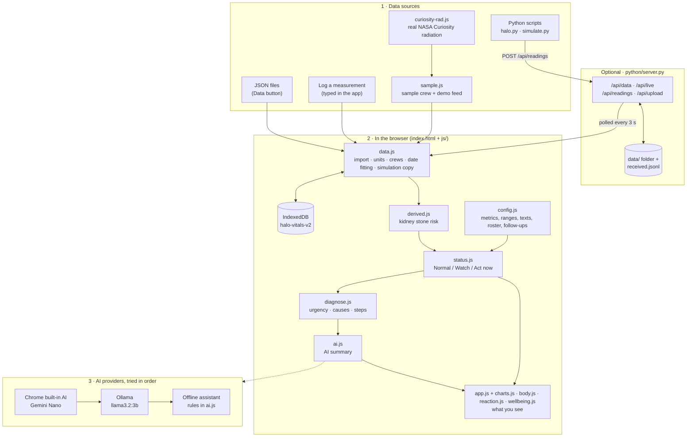
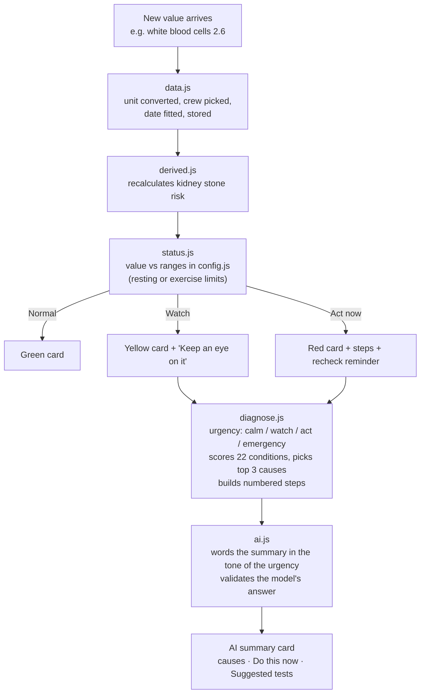
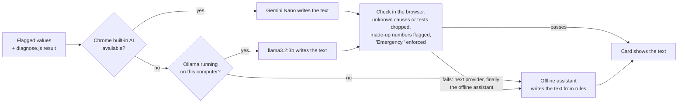

# CHC · Cabin Health Companion

**CHC** is a health companion for astronauts on a 30-day transit to Mars. It brings everything about one crew member's health together on one screen:

- **Continuous data**: a Bio-Monitor shirt (heart rate and ECG, blood oxygen, blood pressure, breathing, skin temperature, activity) and the cabin radiation monitor.
- **Scheduled checks**: daily check-ins, a finger-prick test every 3 days, a blood draw every 2 weeks, and urine tests.
- **Clear statuses**: every value is **Normal**, **Watch** or **Act now**, and the body figure shows where the problem is.
- **AI summary**: up to 3 possible causes, numbered steps, which tests to do next and when to get the Crew Medical Officer. It runs in the browser and works fully offline.
- **Reaction test** (vigilance test and a circle game) with a crew scoreboard, a **Wellbeing** page, and a **simulation** mode that plays through emergencies.

It is plain HTML, CSS and JavaScript: no frameworks, no build step, nothing to install. An optional Python server lets the data team send live data from their scripts.

> Hackathon prototype for a NASA challenge, not a medical device. The crew members are real people (the Vast-PAM-1 crew); their health numbers are not. See [Limits](#limits-worth-saying-out-loud).

---

## Contents

1. [Quick start](#quick-start)
2. [Technical scheme](#technical-scheme)
3. [What is on the screen](#what-is-on-the-screen)
4. [Crew members and sample data](#crew-members-and-sample-data)
5. [Loading data](#loading-data)
6. [Simulate a situation](#simulate-a-situation)
7. [AI summary](#ai-summary)
8. [The Python part](#the-python-part)
9. [Changing the app](#changing-the-app)
10. [Files](#files)
11. [Limits worth saying out loud](#limits-worth-saying-out-loud)

---

## Quick start

### What you need

| | Needed for | Version |
|---|---|---|
| A web browser | everything | Chrome, Edge, Firefox or Safari, a recent version. Chrome or Edge recommended |
| Python | only option B (the server) | 3.8 or newer, standard library only: nothing to `pip install` |
| Node.js | only the optional scripts in `tools/` | any recent version |
| Ollama | only the optional local AI model | see [AI summary](#ai-summary) |

### Option A: just open it (no install)

1. Unzip the project (if you got it as a zip).
2. Double-click **`index.html`**.

That's it. The app opens with the sample crew (Aleš Svoboda, Thomas Pesquet, Adrianos Golemis) and a live demo feed that adds new sensor values every 5 seconds. Everything works offline, including the AI summary. Load your own data with the **Data** button at the top right.

### Option B: with the Python server (recommended for the demo)

The server loads every JSON file in `data/` automatically and lets Python scripts push live readings into the open page.

**Windows:** double-click **`start-server.bat`**. It starts the server and opens http://127.0.0.1:8000 in your browser.

**macOS / Linux** (or Windows from a terminal):

```bash
cd python
python3 server.py        # on Windows: py -3 server.py  or  python server.py
```

Then open **http://127.0.0.1:8000**. Stop the server with **Ctrl+C**.

Options:

```bash
python3 server.py --port 8080        # another port, if 8000 is taken
python3 server.py --host 0.0.0.0     # reachable from a phone or tablet on the same Wi-Fi:
                                     # open http://<this computer's IP>:8000 there
```

If `data/` holds no data files of your own, the app shows the sample crew until real data arrives.

### First things to try (a 2-minute tour)

1. **Switch crew member**: click the name at the top. The small **i** next to each name shows who they are.
2. **Open a value**: click any card (for example *Heart rate*). The panel explains why it matters, how it is measured, and has **Log a measurement**.
3. **Simulate an emergency**: click **Simulate** → *Radiation damage to the blood* (or any other situation). Watch the cards turn red and the AI summary tell you what to do. Click **Stop simulation** to go back.
4. **Reaction test**: click **Reaction test** → *Circles* → play, then look at the crew scoreboard.
5. **Wellbeing**: daily check-in, private journal and crew connection.

### Trouble?

| Problem | Fix |
|---|---|
| `python` is not recognised (Windows) | Install Python from https://www.python.org/downloads/ and tick **Add python.exe to PATH**, or use `py -3 server.py` |
| "Address already in use" | Another program uses port 8000: `python server.py --port 8080`, then open http://127.0.0.1:8080 |
| The page looks old after an update | The app keeps an offline copy. Reload with **Ctrl+F5** (Mac: **Cmd+Shift+R**) |
| You want to start from scratch | **Data** → *Remove loaded data* (clears what this browser stored) |
| The AI card says "Offline assistant" | That is normal: it always works. For a language model see [AI summary](#ai-summary) |

---

## Technical scheme

### Overview



In words: every source ends up in **`data.js`**, which turns it into one time series per metric and per crew member and stores it in the browser (IndexedDB). **`status.js`** judges each latest value against the ranges in **`config.js`**. **`diagnose.js`** turns the flagged values into an urgency level, possible causes and steps. **`ai.js`** only puts that into words (with a language model if there is one, or with its own rules), and **`app.js`** draws everything.

### How a value becomes advice



Emergency means a value past the limits in `EMERGENCY` (`js/diagnose.js`) or 3 or more Act now results at once.

### Where the AI summary comes from



The model never decides anything: the statuses, urgency, causes and steps all come from the app's code, so the safety steps are the same with or without a model.

### Plain-text version (for editors that don't draw diagrams)

```
 SOURCES                         BROWSER (index.html + js/, all offline)                 OUTPUT
 ───────                         ───────────────────────────────────────                 ──────
 JSON files ──┐                  config.js  (metrics, ranges, texts, roster)
 Log a value ─┤                      │
 sample.js ───┼──► data.js ──► derived.js ──► status.js ──► diagnose.js ──► ai.js ──► AI summary card
 (+ Curiosity │    (import,         (kidney      (Normal/      (urgency,     (Chrome AI │
  radiation)  │     units, crews,    stone        Watch/        causes,       → Ollama   │
 server.py ───┘     dates, sim)      risk)        Act now)      steps)        → rules)   │
  ▲   (/api/live, polled 3 s)        │                │                                  ▼
  │                              IndexedDB         app.js ──► charts.js, body.js, reaction.js, wellbeing.js
 Python scripts (halo.py, simulate.py)
```

### Modules

All browser code lives in one namespace, `window.Halo`, loaded with plain `<script>` tags in this order (each file uses the ones above it):

| # | File | Namespace | Job |
|---|---|---|---|
| 1 | `js/config.js` | `HALO_CONFIG` | **The file to edit.** Every metric (units, ranges, schedule, texts: *why it matters*, *how it is measured*, what to do), the crew roster, follow-up rules, AI settings |
| 2 | `js/data.js` | `Halo.data` | Import of any file shape, unit conversion, crew members, date fitting, IndexedDB storage, queries, the simulation copy |
| 3 | `js/derived.js` | `Halo.derive` | Values the app calculates itself (kidney stone risk, 0–5 risk factors) |
| 4 | `js/status.js` | `Halo.status` | Normal / Watch / Act now, exercise detection, due checks, radiation totals |
| 5 | `js/curiosity-rad.js` | `Halo.curiosity` | Real Curiosity radiation data, packed for offline use (generated) |
| 6 | `js/sample.js` | `Halo.sample` | Sample crew data and the live demo feed |
| 7 | `js/charts.js` | `Halo.charts`, `Halo.fmt` | SVG charts, ECG strip, number and date formatting |
| 8 | `js/body.js` | `Halo.body` | The body figure |
| 9 | `js/reaction.js` | `Halo.reaction` | Reaction test page (vigilance test, circles) and the crew scoreboard |
| 10 | `js/diagnose.js` | `Halo.diagnose` | Emergency limits, 22 possible causes, urgency, steps, simulation situations, reasons for tests |
| 11 | `js/ai.js` | `Halo.ai` | The AI summary card: providers, prompt, answer check, offline assistant |
| 12 | `js/wellbeing.js` | `Halo.wellbeing` | Wellbeing page: check-in, journal, crew connection |
| 13 | `js/app.js` | `Halo.app` | Rendering, interaction, dialogs, routing (`#reaction-test`, `#wellbeing`, `#limits`), server connection |
| – | `sw.js` | – | Service worker: offline copy of the app when opened from a web address |

### Stored in the browser (IndexedDB `halo-vitals-v2`)

| Key | What |
|---|---|
| `uploads` | All crew members' data (imported files, live data) |
| `manual` | Values logged with *Log a measurement* |
| `rechecks` | *Remind me to recheck* reminders |
| `reaction_scores` | Circle game results for the scoreboard |
| `journal`, `moments` | Wellbeing journal and shared moments. **Never** part of reports, exports or the AI summary |

Simulated values are never stored: they live on a temporary copy of the data.

### Server API (`python/server.py`)

| Method | Path | Does |
|---|---|---|
| GET | `/api/status` | `{"app": "chc", "files": n, "seq": n}` |
| GET | `/api/data` | Every data file in `data/` (examples excluded) plus `received.jsonl` |
| GET | `/api/live?since=N` | Live chunks posted after sequence number N (the page polls every 3 s) |
| POST | `/api/readings` | Live readings from scripts: `{"readings": [...], "series": [...]}`. Saved to `data/received.jsonl` |
| POST | `/api/upload?name=x.json` | A data file from the app, saved as `data/x.json` |

---

## What is on the screen

1. **Header**: logo, crew member menu (with **i** profiles), "Mars transit · Day N of 30", and buttons for Wellbeing, Reaction test, Limits, Simulate and Data.
2. **Summary**: one sentence on how things stand, then everything on Watch or Act now with the first thing to do. Each item opens its details.
3. **Body figure**: body systems coloured by their worst current status. Pick one to list its indicators. (Small credit: "Figure created by Claude".)
4. **AI summary**: see [AI summary](#ai-summary).
5. **Bio-Monitor** (every value is labelled "Measured by the Bio-Monitor"): heart rate with ECG strip, blood oxygen, blood pressure, breathing rate and volume, skin temperature, activity. Values are the median of the last few minutes. During exercise (3 METs or more), heart rate, blood pressure and breathing are judged against exercise limits; for heart rate that is up to 90% of the maximum (220 minus age).
6. **Radiation**: active dose rate now with the last 6 hours, the dose in the last 24 hours, and the cumulative dose since launch against NASA's career limit, in gray (about 157 mGy: NASA's 600 mSv divided by the deep-space quality factor 3.82). The sample radiation is real data from NASA's Curiosity rover.
7. **Time range**: Day / 1 week / 2 weeks / Month, with arrows to step back. It applies to the trends, checks and detail panels.
8. **Trends**: all Bio-Monitor channels on one shared time axis; exercise periods are shaded.
9. **Checks**: what is due or overdue, a 7-day routine score, and cards per schedule:
   - **Every day**: sleep, mood, crew connection, exercise.
   - **Every week**: body mass, body temperature, reaction time, urine dipstick (pH, concentration).
   - **Blood tests**: fasting finger-prick every 3 days (fasting blood glucose, lactate, haemoglobin), blood draw every 2 weeks (white blood cells, sodium, ferritin).
   - **Kidneys and urine**: monthly 24-hour urine test (volume, calcium, oxalate, citrate) and the **kidney stone risk** worked out from them.
10. **Detail panel** (click anything): current value, what to do now, when to get the Crew Medical Officer, a chart, **why it matters**, **how it is measured**, **Log a measurement**, and "Check these next" follow-up tests.
11. **No doctor on board, so the app guides the crew**: every Watch and Act now comes with steps the astronaut can carry out, a clear point at which to get the **Crew Medical Officer**, and **Remind me to recheck**. The **Health report for the Crew Medical Officer** puts everything into one text to copy, save or send home.
12. **Reaction test** (`index.html#reaction-test`):
    - **Vigilance test**: 1 or 3 minutes, based on the psychomotor vigilance test. Average and median reaction time, lapses (over 0.5 s) and false starts. Saved as the weekly reaction time.
    - **Circles**: 20 circles pop up at random, each for 1.5 s. Score = average time per circle (a miss counts 1.5 s, a click beside a circle adds 0.1 s). Only for the scoreboard.
    - **Crew scoreboard**: vigilance test ranked by latest result (with the change from each person's own baseline), circles ranked by best score.
13. **Wellbeing page** (`index.html#wellbeing`): daily check-in, private journal with prompts, a log of shared moments with the crew, and 30-day charts of mood, crew connection and sleep.
14. **Limits page** (`index.html#limits`): every indicator's Normal / Watch / Act now values as coloured bars, and where each limit comes from. Built from `js/config.js`, so it always matches the app.

Status words: **Normal**, **Watch**, **Act now**, plus Exercising, No signal, Out of date and No data.

---

## Crew members and sample data

Each astronaut's data is kept apart by the name in the file: `"crew": {"name": "Aleš Svoboda"}` for a whole file, or `"crew": "Thomas Pesquet"` on a single reading or series. Names are matched without accents or capitals ("Ales Svoboda" = "Aleš Svoboda"). Data without a name goes to the crew member on screen.

**The sample crew** is the real crew named for Vast-PAM-1, the private ISS mission planned for 2027: **Aleš Svoboda** (pilot, shown first), **Thomas Pesquet** (commander) and **Adrianos Golemis** (mission specialist). Their profiles, with public sources, are in `roster` in `js/config.js`. Astronauts' medical data is not public, so their health numbers are not theirs:

- **Blood draws and finger-pricks** come from the team's data files. Aleš gets them as they are; Thomas and Adrianos get adjusted versions of the same baseline (`TEAM_FIT` in `js/sample.js`). Dates follow the mission calendar: day 1 is 29 days before today.
- **Radiation** is real: NASA's Curiosity rover measured it on its cruise to Mars, moved in time to end today. All three share the cabin, so they get the same values.
- **Everything else** is generated inside the valid ranges, with a story per person: Aleš has short nights and slower reactions, Thomas is steady, Adrianos drinks too little.

`node tools/export-sample.js` writes the sample files to `data/sample-crew-*.json` and the team's files per astronaut to `data/team/`.

---

## Loading data

Use the **Data** button (drop files in), or put files in `data/` when using the server. The format is described in **[DATA.md](DATA.md)**. The app also reads:

- **Rows with several measurements as columns**, e.g. `{"timestamp": "...", "heart_rate_bpm": 62, "spo2_pct": 97}`. A unit at the end of a column name is understood (`_bpm`, `_pct`, `_c`, `_ugy_h`, `_msv`, `_mmol_l`…).
- **Units written any common way**: "µGy/h", "uGy/hr", "microgray/hour", "mGy per day", "mmol/l", "ng/mL".
- **Radiation in any unit.** The app works in gray: rates go to the active dose rate (µGy/h), doses to the daily dose (mGy). Files in sievert (µSv/h, mSv) are converted with the quality factor 3.82 that Curiosity measured. **Always put the unit on radiation data**; a series without a unit is read as µGy/h.
- **NASA Curiosity (MSL) RAD cruise files** (detector E is used). The converted data is in `data/radiation-msl-cruise.json`.

**Dates are fitted to the 30-day mission.** A file that does not end around today is moved forward in whole days to end today, and only the last 30 days are kept. Files from the same period are moved by the same amount, so teammates' data stays lined up. The import report says what was moved.

---

## Simulate a situation

**Simulate** (top right, or at the bottom of the AI summary) makes the whole dashboard and the AI summary react as if a situation were real:

| Situation | What it sets |
|---|---|
| High heart rate at rest | heart rate 158 |
| High radiation (solar storm) | dose rate 1780 µGy/h |
| Low blood oxygen | blood oxygen 86% |
| Cabin air problem (CO2) | low oxygen, fast breathing, slower reactions |
| Infection with high fever | 39.7 °C, high white blood cells |
| High blood pressure | 186/122 mmHg |
| Low blood sugar | glucose 46 mg/dL |
| Dehydration | concentrated, scant urine, high sodium |
| Kidney stone forming | 24-hour urine test with all 5 kidney stone risk factors |
| Radiation damage to the blood | white blood cells 2.6, haemoglobin 12.4, dose 420 mGy after a solar particle event |
| Exhausted, little sleep | 4 hours of sleep, slower reactions |
| Normal vital signs | everything at resting values |

You can also set your own values for any measurement. Sensors you don't set get normal resting values, so only what you chose is off. A blue bar shows that a simulation is running. **Nothing is saved**: stopping the simulation, logging a real value, importing or switching crew member brings the real data back.

---

## AI summary

The card under the summary and the body figure gives:

- an **urgency level** and a summary whose tone follows it: relaxed (all normal), calm (Watch), firm (Act now), or a red **Emergency** card that says plainly what is dangerous and to act now;
- **What could be causing it**: up to 3 possible causes with the results that point to them, a short explanation and how to check;
- **Do this now**: numbered steps, including when to get the Crew Medical Officer and to message mission control without waiting (the signal delay to Mars is up to 22 minutes one way);
- **Suggested tests**: up to 3 next measurements, each with the reason, and a Log button.

It updates after every new value. It is English only. Providers, tried in order (see the diagram above):

1. **Chrome's built-in AI** (Gemini Nano, on the device): desktop Chrome 148+ with enough memory. The card offers **Turn on Chrome's on-device AI** the first time (a one-time model download).
2. **Ollama** on this computer, called directly from the page.
3. **Offline assistant**: no model, no internet, always works.

**Optional: set up Ollama** (works in any browser)

1. Install Ollama: https://ollama.com/download
2. Download the model (about 2 GB): `ollama pull llama3.2:3b`
3. Let web pages talk to it, then restart Ollama:
   - Windows: `setx OLLAMA_ORIGINS "*"`
   - macOS: `launchctl setenv OLLAMA_ORIGINS "*"`
   - Linux: `OLLAMA_ORIGINS="*" ollama serve`
4. Open the app and press **Re-run**. The card should say "Ollama · llama3.2:3b".

`OLLAMA_ORIGINS="*"` lets any web page reach your local Ollama: fine on a demo laptop, undo it afterwards if you like (`setx OLLAMA_ORIGINS ""`). The model and address are set in `ai` in `js/config.js`.

The possible causes are prompts to think and act, not a diagnosis. The Wellbeing journal is never used.

---

## The Python part

```
python/server.py     serves the app, loads data/, accepts live readings (see the API table above)
python/halo.py       helpers for the data team: build, check, save and send data
python/simulate.py   example Bio-Monitor simulation based on averages
start-server.bat     Windows shortcut: starts the server and opens the browser
```

**How data reaches the app with the server running:**

1. **Files**: a script writes a JSON file into `data/`, then you reload the page. Example files (`sample-mission.json`, `sample-crew-*.json`, `template.json`, `example-second-crew-member.json`, `radiation-msl-cruise.json`) are not loaded automatically; load them with the Data button.
2. **Live**: a script sends readings (`halo.send(...)`); the page shows them within 3 seconds. They are also saved to `data/received.jsonl`, so they survive a restart.
3. **From the app**: files dropped into the Data dialog and values logged by hand are saved on the server too.

**Write a file:**

```python
import halo
ds = halo.Dataset(crew={"name": "Aleš Svoboda", "role": "Pilot"})
ds.add_series("heart_rate", values=[62, 63, 61], start="2026-11-14T08:00:00Z", interval_s=60)
ds.add_reading("body_mass", 71.8, time="2026-11-10T07:30:00Z")
ds.add_reading("glucose", 5.1, unit="mmol/L")          # time defaults to now (UTC)
problems = ds.save("../data/my-data.json")             # [] means the app will accept everything
```

**Send live readings:**

```python
halo.send({"readings": [{"metric": "heart_rate", "time": halo.now(), "value": 64}]})
```

**Check files before handing them over:** `python halo.py ../data/*.json` lists anything the app would skip (unknown metrics, unreadable times, impossible values). It reads the metric list from `js/config.js`, so Python and the app always agree.

**Simulation:** `python simulate.py` sends live samples every 5 seconds; `python simulate.py --days 30` writes a 30-day history file instead.

---

## Changing the app

| To change | Edit |
|---|---|
| A range (Normal / Watch), a unit, a text, how often something is measured | the metric in `js/config.js` (`range`, `unit`, `why`, `how`, `every`…) |
| Which tests are suggested when something is off | `followups` at the bottom of `js/config.js` |
| A crew profile | `roster` in `js/config.js` |
| A possible cause, its steps or emergency steps | `CONDITIONS` in `js/diagnose.js` |
| Emergency limits | `EMERGENCY` in `js/diagnose.js` |
| A simulation situation | `SCENARIOS` in `js/diagnose.js` |
| Colours and fonts | the top of `css/style.css` |
| The AI model or Ollama address | `ai` in `js/config.js` |

After changing files, bump `VERSION` in `sw.js` so browsers that opened the app from a web address pick up the new version.

---

## Files

```
index.html             page structure
css/style.css          all styling; colours and fonts at the top
img/                   logo and app icons (chc-logo.svg/.png, logo.png, icon-32/180/192/512.png)
js/                    the app (see Modules above)
sw.js                  offline copy of the app when opened from a web address
manifest.webmanifest   lets the app be installed like an app
data/                  sample-mission.json, sample-crew-*.json (sample crew), template.json (minimal),
                       radiation-msl-cruise.json (real Curiosity radiation), radiation-30d-gray.json (team file),
                       example-second-crew-member.json, team/ (team blood and finger-prick files per astronaut)
python/                server, data helpers and simulation
start-server.bat       Windows shortcut for the Python server
tools/                 optional Node scripts: export-sample.js, build-curiosity-js.js,
                       export-second-crew.js, convert-msl-rad.js
DATA.md                data format for the team
RESOURCES.md           every tool and source the project uses, and every assumption
```

---

## Limits worth saying out loud

- Most ranges are general adult reference values; ferritin and haemoglobin ranges were set by the team. None are NASA flight limits. Each indicator shows where its range comes from (detail panel and Limits page). Sources: [RESOURCES.md](RESOURCES.md).
- The crew members are real; their health numbers are not (team data, adjusted per person, plus generated values). Putting them on a Mars transit is our scenario.
- The radiation data is real Curiosity data from 2011–2012, moved in time to fit the mission.
- The ECG strip replays a recorded shape; the app does not analyse heart rhythm.
- The emergency limits, causes and steps are a hackathon prototype, not a medical device. The Crew Medical Officer decides on treatment.
