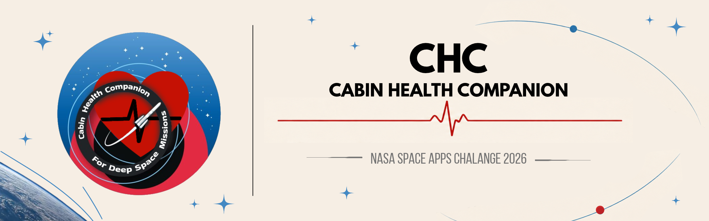
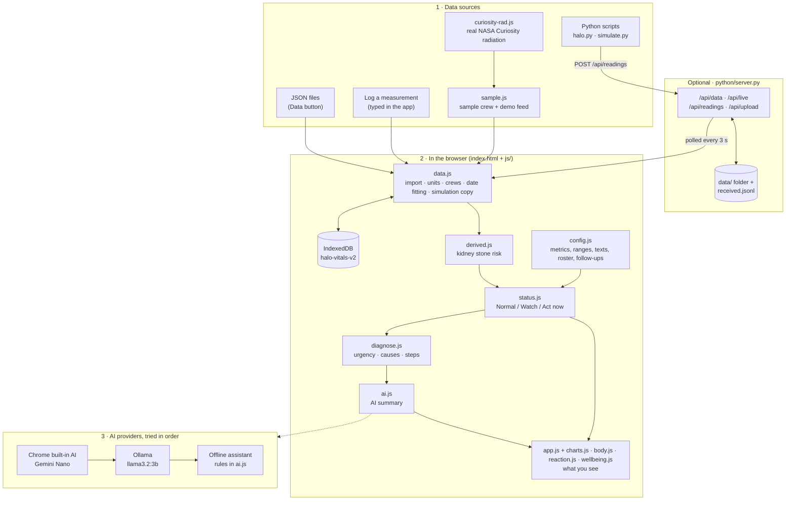
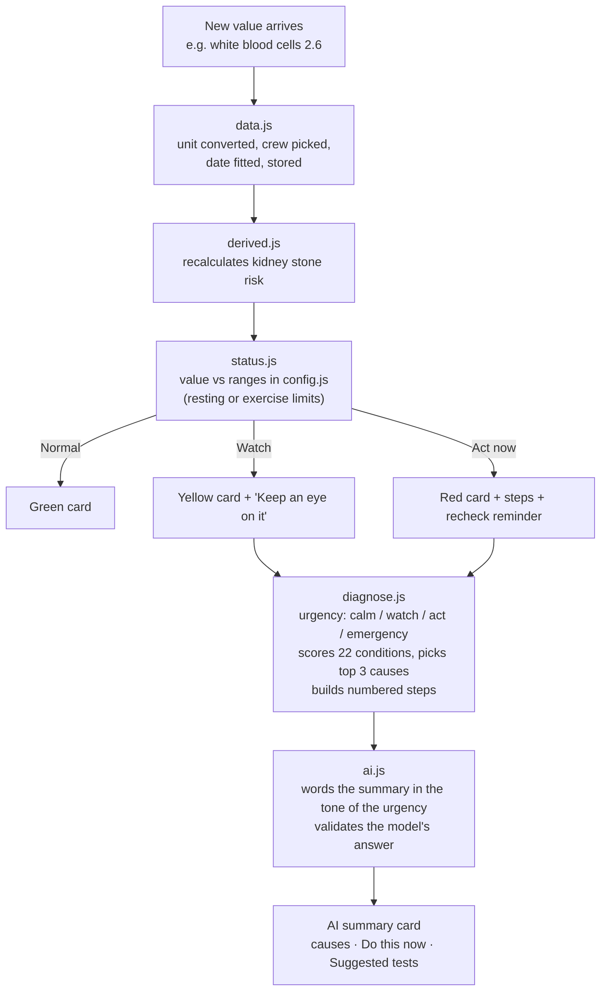
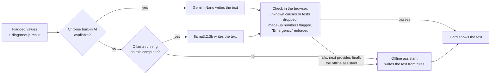

<div align="center">



<br>


<br>
</div>

---


A health companion for astronauts on a deep space mission. It puts everything about one crew member's health on one screen:

- **Continuous data** from a Bio-Monitor shirt (heart rate and ECG, blood oxygen, blood pressure, breathing, skin temperature, activity) and the cabin radiation monitor.
- **Scheduled checks**: daily check-ins, a finger-prick test every 3 days, a blood draw every 2 weeks, urine tests.
- **Clear statuses**: every value is **Normal**, **Watch** or **Act now**, and the body figure shows where the problem is.
- **AI summary**: possible causes, numbered steps, which tests to do next and when to get the Crew Medical Officer. Runs in the browser, fully offline.
- **Reaction test** with a crew scoreboard, a **Wellbeing** page, and a **simulator** for playing through emergencies.

Plain HTML, CSS and JavaScript: no frameworks, no build step, nothing to install. An optional Python server lets the data team stream live data.

> Hackathon prototype for a NASA challenge, not a medical device. The crew members are real people (the Vast-PAM-1 crew); their health numbers are not.

---

## Quick start

| You need | For |
|---|---|
| A recent browser (Chrome or Edge recommended) | everything |
| Python 3.8+ (standard library only) | only the server (option B) |

**Option A, no install:** double-click **`index.html`**. It opens with the sample crew and a live demo feed (new sensor values every 5 s). Load your own data with the **Data** button.

**Option B, Python server** (loads every file in `data/` and accepts live readings from scripts):

- **Windows:** double-click **`start-server.bat`**. It opens http://127.0.0.1:8000 for you.
- **macOS / Linux:** `cd python && python3 server.py`, then open **http://127.0.0.1:8000**. Stop it with **Ctrl+C**.
- Other port: `--port 8080`. Open it from a phone on the same Wi-Fi: `--host 0.0.0.0`.

**First things to try:** switch crew member at the top (the **i** shows who they are) · click any card for details · **Simulate** → *Radiation damage to the blood* · **Reaction test** → *Circles*.

| Trouble | Fix |
|---|---|
| `python` not recognised (Windows) | Install Python with **Add python.exe to PATH** ticked, or run `py -3 server.py` |
| "Address already in use" | `python server.py --port 8080`, then open http://127.0.0.1:8080 |
| The page looks old after an update | Hard-refresh: **Ctrl+F5** (Mac: **Cmd+Shift+R**) |
| Start from scratch | **Data** → *Remove loaded data* |

---

## Technical scheme

### Overview



Every source ends up in **`data.js`**, which keeps one time series per metric and crew member and stores it in the browser. **`status.js`** judges values against the ranges in **`config.js`**, **`diagnose.js`** turns the flagged ones into urgency, causes and steps, **`ai.js`** puts that into words, and **`app.js`** draws it.

### How a value becomes advice



Emergency = a value past the limits in `EMERGENCY` (`js/diagnose.js`), or 3+ Act now results at once.

### Where the AI summary comes from



The model never decides anything: statuses, causes and steps come from the code, so the safety steps are the same with or without a model.

### Modules

Loaded with plain `<script>` tags in this order, all under `window.Halo`:

| File | Job |
|---|---|
| `js/config.js` | **The file to edit**: every metric (units, ranges, schedule, texts), crew roster, follow-up rules |
| `js/data.js` | Import of any file shape, units, crew members, date fitting, storage, simulation copy |
| `js/derived.js` | Values the app calculates (kidney stone risk) |
| `js/status.js` | Normal / Watch / Act now, exercise detection, due checks |
| `js/curiosity-rad.js` · `js/sample.js` | Real Curiosity radiation · sample crew and demo feed |
| `js/charts.js` · `js/body.js` | SVG charts and ECG strip · body figure |
| `js/reaction.js` | Reaction test and crew scoreboard |
| `js/diagnose.js` | Emergency limits, 22 possible causes, steps, simulation situations |
| `js/ai.js` | AI summary: providers, answer check, offline assistant |
| `js/wellbeing.js` · `js/app.js` | Wellbeing page · rendering, dialogs, routing, server connection |
| `sw.js` | Offline copy of the app when opened from a web address |

**Stored in the browser** (IndexedDB `halo-vitals-v2`): crew data (`uploads`), logged values (`manual`), reminders (`rechecks`), circle scores (`reaction_scores`), and the Wellbeing journal (`journal`, `moments`), which never goes into reports, exports or the AI.

**Server API** (`python/server.py`):

| | |
|---|---|
| `GET /api/data` | every data file in `data/` (examples excluded) plus `received.jsonl` |
| `GET /api/live?since=N` | live readings after N (the page polls every 3 s) |
| `POST /api/readings` | live readings from scripts, saved to `data/received.jsonl` |
| `POST /api/upload?name=x.json` | a file from the app, saved to `data/` |

---

## What's on the screen

- **Header**: crew member menu with **i** profiles, "Mars transit · Day N of 30", Wellbeing, Reaction test, Limits, Simulate, Data.
- **Summary + body figure + AI summary**: what's off, where, and what to do.
- **Bio-Monitor**: live sensor values (median of the last few minutes); exercise is detected and judged against exercise limits.
- **Radiation**: dose rate now, last 24 hours, and total since launch against NASA's career limit. Sample data is real Curiosity data.
- **Trends**: all sensors on one time axis (day, week, 2 weeks, month).
- **Checks**: what's due, and cards for daily, weekly, blood (finger-prick every 3 days, blood draw every 2 weeks) and urine tests, plus the kidney stone risk.
- **Detail panel** (click anything): what to do, when to get the Crew Medical Officer, a chart, **why it matters**, **how it is measured**, **Log a measurement**, and follow-up tests.
- **Reaction test** (`#reaction-test`): a 1–3 minute vigilance test (saved as reaction time) and a 20-circle game, with a crew scoreboard.
- **Wellbeing** (`#wellbeing`): check-in, private journal, crew connection. **Limits** (`#limits`): every range as coloured bars, with its source.

---

## Simulate a situation

**Simulate** makes the dashboard and AI summary react as if a situation were real. Nothing is saved, and **Stop simulation** brings the real data back.

| Situation | Sets |
|---|---|
| High heart rate at rest | heart rate 158 |
| High radiation (solar storm) | dose rate 1780 µGy/h |
| Low blood oxygen · Cabin air problem | blood oxygen 85–86%, fast breathing |
| Infection with high fever | 39.7 °C, high white blood cells |
| High blood pressure · Low blood sugar | 186/122 mmHg · glucose 46 mg/dL |
| Dehydration · Kidney stone forming | concentrated urine, high sodium · all 5 kidney stone risk factors |
| Radiation damage to the blood | white blood cells 2.6, dose 420 mGy after a solar particle event |
| Exhausted, little sleep · Normal vital signs | 4 h sleep, slow reactions · everything at rest |

You can also set your own values for any measurement.

---

## Data

- **Crew members** are kept apart by the name in the file (`"crew": {"name": "Aleš Svoboda"}`), matched without accents. Data without a name goes to whoever is on screen.
- **The sample crew** is the real Vast-PAM-1 crew (Aleš Svoboda, Thomas Pesquet, Adrianos Golemis), profiles with sources in `roster` in `js/config.js`. Blood tests come from our team's files (adjusted per person), radiation from NASA's Curiosity rover, the rest is generated within normal ranges.
- **Any file shape** works: the team format ([DATA.md](DATA.md)), rows with columns like `heart_rate_bpm`, units written any common way, and NASA Curiosity RAD files. **Always put the unit on radiation data.**
- **Dates are fitted** to the 30-day mission: older data is moved forward in whole days to end today, and only the last 30 days are kept.

---

## AI summary

Tried in order: **Chrome's built-in AI** (Gemini Nano, desktop Chrome 148+), then **Ollama** on this computer, then the **offline assistant**, which always works. English only.

**Optional Ollama setup:** install from https://ollama.com/download, run `ollama pull llama3.2:3b`, set `OLLAMA_ORIGINS="*"` (Windows: `setx OLLAMA_ORIGINS "*"`) and restart Ollama. The card should then say "Ollama · llama3.2:3b".

---

## Python tools

```python
import halo
ds = halo.Dataset(crew={"name": "Aleš Svoboda", "role": "Pilot"})
ds.add_reading("glucose", 5.1, unit="mmol/L")                 # time defaults to now
problems = ds.save("../data/my-data.json")                    # [] = the app accepts everything
halo.send({"readings": [{"metric": "heart_rate", "time": halo.now(), "value": 64}]})   # live, server must run
```

- `python halo.py ../data/*.json` checks files before you hand them over.
- `python simulate.py` streams live samples every 5 s; `--days 30` writes a history file instead.

---

## Changing the app

| To change | Edit |
|---|---|
| A range, unit, text or schedule | the metric in `js/config.js` |
| Suggested follow-up tests | `followups` in `js/config.js` |
| Possible causes and their steps · emergency limits | `CONDITIONS` · `EMERGENCY` in `js/diagnose.js` |
| Simulation situations | `SCENARIOS` in `js/diagnose.js` |
| Colours and fonts | top of `css/style.css` |

After changing files, bump `VERSION` in `sw.js` so browsers pick up the new version.

---

## Files

```
index.html, css/, img/   page, styling, logo and icons
js/                      the app (see Modules)
data/                    sample crew, our team's files (data/team/), real Curiosity radiation
python/                  server, data helpers, simulation · start-server.bat for Windows
tools/                   optional Node scripts that rebuild the sample files
DATA.md · RESOURCES.md   data format · every source and assumption
```

---

## Limits

- Ranges are general adult reference values (ferritin and haemoglobin set by the team), not NASA flight limits. Sources: [RESOURCES.md](RESOURCES.md).
- The crew members are real; their health numbers are not. The radiation is real Curiosity data from 2011–2012, moved in time.
- A hackathon prototype, not a medical device: the Crew Medical Officer makes the call.
